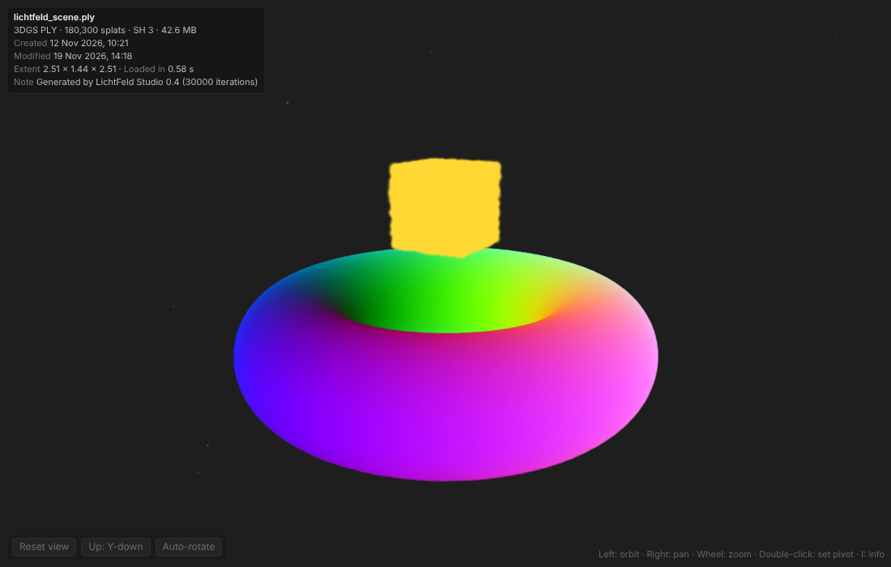

# Splat QuickLook

Press **Space** on a Gaussian splat or a point cloud and see it in 3D, the way you preview an image. No need to open Postshot, SuperSplat, Blender or CloudCompare just to check a file.

- **Windows**: plugin for [QuickLook](https://github.com/QL-Win/QuickLook)
- **macOS**: app with a native Quick Look extension (Space in Finder) and a standalone viewer



## Supported files

| Type | Extensions |
|---|---|
| Gaussian splats | `.ply` (3DGS, incl. SuperSplat compressed), `.splat`, `.ksplat`, `.spz`, `.sog` |
| Point clouds | `.ply` with points only (e.g. COLMAP `sparse.ply`, Metashape, scanners) |

On Windows, `.ply` meshes are left to QuickLook's built-in 3D viewer; on macOS they open in this viewer too.

## Features

- Orbit with the mouse: **left** orbit · **right** pan · **wheel** zoom · **double-click** sets the pivot
- Smart framing that ignores far-away floaters
- Up axis toggle: **Y-down** (COLMAP / most 3DGS trainers), **Z-up** (scanners, Metashape), **Y-up**, remembered per file type
- Compact info panel (top-left): format, splat/point count, SH degree, file size, created/modified dates, scene extent, load time, PLY header comment (e.g. the software that generated it)
- Point size slider for point clouds, auto-rotate
- Keys: `R` reset view · `U` up axis · `A` auto-rotate · `I` collapse info

## Install

### Windows

1. Install [QuickLook](https://github.com/QL-Win/QuickLook) (Microsoft Store or GitHub).
2. Download `QuickLook.Plugin.SplatViewer.qlplugin` from the [latest release](../../releases/latest).
3. Select it in Explorer, press **Space**, click **Install**, then restart QuickLook.

Requires the Microsoft Edge WebView2 Runtime (preinstalled on Windows 10/11).

### macOS (13 Ventura or later, Apple Silicon and Intel)

Paste this in **Terminal**:

```bash
curl -fsSL https://github.com/gabriverga/splat-quicklook/releases/latest/download/install-mac.sh | bash
```

It downloads the app, puts **Splat Viewer** in Applications and enables the Quick Look extension. Then select a splat in Finder and press **Space**.

Prefer to download first? Get `SplatViewer-mac.zip` and `install-mac.sh` from the [latest release](../../releases/latest) and run `bash ~/Downloads/install-mac.sh`.

<details>
<summary>Manual install</summary>

1. Download `SplatViewer-mac.zip` from the [latest release](../../releases/latest), unzip it, move **Splat Viewer** to Applications.
2. Open it. macOS will block it because the app isn't notarized by Apple: go to **System Settings › Privacy & Security**, click **Open Anyway** (within an hour of the first attempt).
3. If Space shows nothing, enable **Splat Viewer** in **System Settings › General › Login Items & Extensions › Quick Look**.

</details>

The app itself is also a viewer: double-click a file, drag it onto the icon, or use **File › Open**.

## How it works

Both versions share the same web viewer (`web/`), built on [Spark](https://sparkjs.dev) and [three.js](https://threejs.org), bundled into the plugin/app and fully offline.

- **Windows**: a C# QuickLook plugin hosts the viewer in WebView2 (reusing the copy QuickLook ships with its HTML viewer). The viewer stays loaded between previews, so after the first one files open almost instantly.
- **macOS**: a Swift Quick Look preview extension hosts the viewer in a WKWebView; files are streamed to the page through a private URL scheme.

Only the PLY header is read up front (a few KB) to tell splats, point clouds and meshes apart.

## Build

Everything builds from the command line, no Visual Studio or Xcode projects. GitHub Actions builds both on every push and attaches them to a release when you push a `v*` tag.

```bash
./windows/build.sh   # Linux/macOS: Node.js, .NET SDK, git, zip  -> windows/build/QuickLook.Plugin.SplatViewer.qlplugin
./mac/build.sh       # macOS: Node.js, Xcode command line tools   -> mac/build/SplatViewer-mac.zip
```

`tools/` has scripts that generate synthetic test files (a 3DGS PLY and a point cloud).

## Roadmap

- LAS / LAZ / E57 point clouds
- Fast low-detail preview for very large files
- Screenshot of the current view
- Finder / Explorer thumbnails

## License

GPL-3.0, like QuickLook. Spark and three.js are MIT licensed.

Made by [Gabriele Verga](https://www.instagram.com/gabriverga/).
